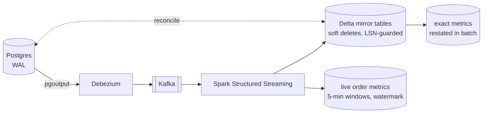

# cdc-streaming-lakehouse

Change data capture from Postgres into Delta Lake with Spark Structured Streaming. It keeps a
lakehouse copy of a live shop database current to within seconds, and it stays correct through
replays, crashes between commits, out-of-order changes, late events and schema changes.



## What it demonstrates

- **Log-based CDC**: Postgres logical replication through `pgoutput`, Debezium envelopes,
  `REPLICA IDENTITY FULL` before images, the initial snapshot followed by live streaming.
- **Idempotent merges**: per-row LSN guard plus Delta transaction ids keyed by streaming batch
  id. A batch can be replayed any number of times.
- **Crash recovery, proven**: a test kills Spark after one table commits and before the next,
  restarts it, and checks the mirror against the source row by row. CI does the same through
  Kafka.
- **Event time and watermarks**: late orders are dropped from live metrics on purpose, then
  recovered by a batch restatement, and the gap between the two is reported.
- **Schema evolution**: an `ALTER TABLE ... ADD COLUMN` partway through the run reaches the
  mirror with nothing to deploy.
- **Reconciliation as the test oracle**: every end-to-end test ends by comparing every row and
  column of Postgres with the mirror.

## Results

`uv run cdclake demo` runs the whole pipeline on an embedded Postgres. One run, 300 orders:

| | |
|---|---|
| Change events captured | 1,588 across 3 tables |
| Mirror vs Postgres | 60 / 278 / 698 live rows in customers / orders / order_items, **0 missing, 0 extra, 0 different** |
| Cancelled orders kept as tombstones | 22 |
| Late orders (synced 2 h after creation) | 2: dropped from live metrics (298 counted), restored by restatement (300) |
| Schema change | `orders.channel` added mid-run, present in the mirror |

## Run it

Needs Python 3.12, [uv](https://docs.astral.sh/uv/) and Java 17 or 21 for Spark. On Windows,
use WSL2 (Ubuntu): Spark's local mode works far better there than in PowerShell.

```bash
uv sync
uv run cdclake demo            # embedded Postgres -> capture -> Spark -> Delta -> reconcile
uv run pytest -v               # 15 tests, about a minute, no Docker
```

The full stack with Debezium and Kafka, as CI runs it:

```bash
docker compose up -d
./scripts/e2e_debezium.sh
```

Step by step, against any Postgres with `wal_level=logical`:

```bash
uv run cdclake setup     --dsn "$DSN" --local-slot
uv run cdclake workload  --dsn "$DSN" --orders 500
uv run cdclake capture   --dsn "$DSN" --out landing/
uv run cdclake stream    --input landing/ --lake lake/ --checkpoints checkpoints/
uv run cdclake reconcile --dsn "$DSN" --lake lake/      # exit code 1 if anything differs
uv run cdclake restate   --lake lake/
```

## When the slot is lost

Every Postgres this project starts sets `max_slot_wal_keep_size` (1 GB; 64 MB in tests). A slot
whose consumer has stopped pins WAL until that bound, then Postgres marks it `lost` and frees the
disk; without the bound the *source* database would fill its volume and stop taking writes.
`cdclake capture` checks `pg_replication_slots.wal_status` first and exits with `SlotLost`
instead of hanging. To recover: drop the slot, re-snapshot the tables into the mirror, run
`cdclake setup` for a new slot. `capture.slot_health()` exposes `safe_wal_size` for alerting
before that point. Rationale: [ADR 0007](docs/adr/0007-bounded-slot-wal-retention.md).

## Tests

| Test file | What it proves |
|---|---|
| `test_capture.py` | pgoutput decoding of inserts, updates and deletes with full before images; UTC timestamps; the slot advances only after files are written, so a crash mid-drain replays instead of losing changes; null and unchanged-TOAST markers; new columns after `ALTER TABLE`; a slot nobody drains is bounded by `max_slot_wal_keep_size`, becomes `lost`, and `drain` refuses with the recovery steps |
| `test_sink.py` | latest change wins within a batch; an older change never overwrites a newer one; deletes become tombstones; a retried batch is skipped by its transaction id (batch 0 included); new source columns are added; a real Debezium message (snapshot `r`, extra fields, timestamps without fractions) applies correctly |
| `test_pipeline.py` | three rounds of traffic, capture and streaming keep the mirror identical to the source; late orders miss live metrics and restatement recovers them exactly; a crash between two table commits recovers with no duplicates |

## How it was verified

| Check | Where | Status |
|---|---|---|
| Lint (ruff), strict types (mypy), 15 tests | Locally; CI job `python` | Pass locally |
| Local demo with reconciliation | Locally | Pass (numbers above) |
| Postgres → Debezium → Kafka → Spark, with snapshot, schema change, forced crash and reconciliation | CI job `debezium` only. The container registries are not reachable from where this was built | Runs on every push; see the Actions tab |

## Design records

- [Architecture](docs/architecture.md): diagrams of the system, the merge decision, crash
  recovery and late data, plus a failure-mode table for operating it.
- [ADR 0001](docs/adr/0001-log-based-cdc-with-debezium.md): log-based CDC with Debezium
- [ADR 0002](docs/adr/0002-soft-delete-mirror-with-lsn-guard.md): key-merged mirror with an LSN guard and tombstones
- [ADR 0003](docs/adr/0003-exactly-once-with-delta-transaction-ids.md): exactly-once with Delta transaction ids
- [ADR 0004](docs/adr/0004-watermarked-live-metrics-plus-restatement.md): watermarked live metrics plus restatement
- [ADR 0005](docs/adr/0005-additive-schema-evolution.md): additive schema evolution as nullable strings
- [ADR 0006](docs/adr/0006-local-pgoutput-capture-for-tests.md): local pgoutput capture for tests, real Debezium in CI
- [ADR 0007](docs/adr/0007-bounded-slot-wal-retention.md): a bound on the WAL a slot may retain, and what happens past it

## Layout

```
src/cdclake/
  schema.py      source tables and DDL
  workload.py    seeded shop traffic, schema change, late syncs
  capture.py     local pgoutput decoder and slot handling
  stream.py      Spark source (Kafka or files), parse(), the two streaming queries
  sink.py        mirror merges, transaction ids, schema evolution, metric upserts
  metrics.py     exact restatement and the live-vs-exact gap
  reconcile.py   row-by-row comparison with Postgres
  cli.py         the cdclake command
docker-compose.yml, debezium/, scripts/e2e_debezium.sh   the production-shaped path
docs/            architecture and ADRs
```

## Limits

- The mirror holds current state, not history. Append the raw change stream to a bronze table
  for history; Project 2 (`card-payments-lakehouse`) shows SCD2.
- New columns arrive as strings until promoted in `schema.py`. Renames, drops and type changes
  need a planned migration (ADR 0005).
- The local decoder handles the types used here. Production capture is Debezium.
- Single-node Kafka with one partition per topic. Partitioning by key keeps per-row order at
  scale, and the LSN guard does not depend on cross-partition order.
