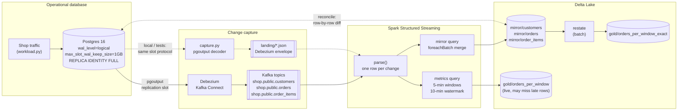
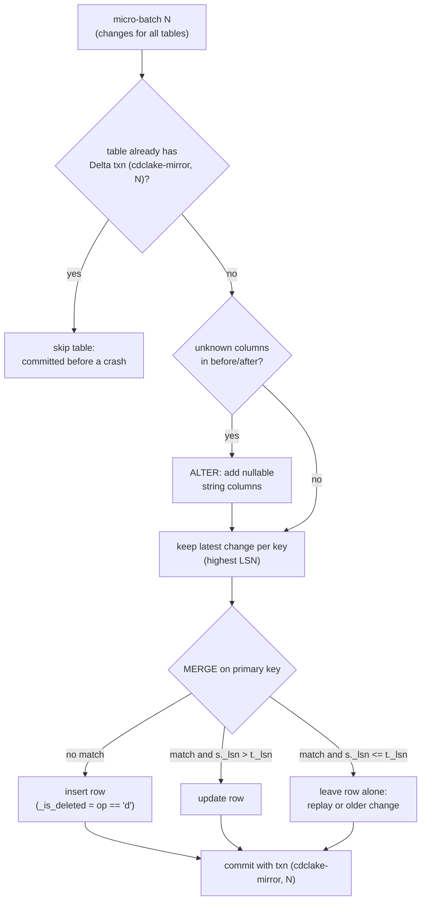
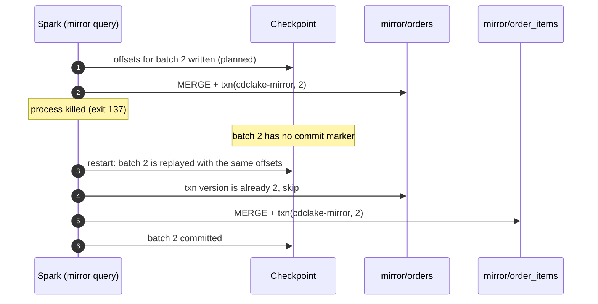
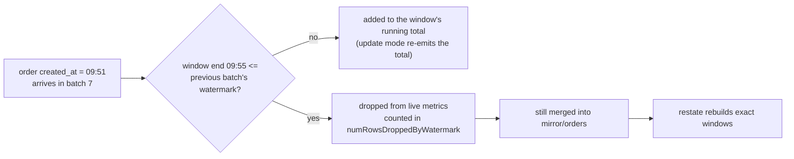

# Architecture

This pipeline keeps a Delta Lake copy of an operational Postgres database current to within
seconds. It also produces live order metrics from the same change feed. Its job is to be
**correct under failure**: replays, crashes between commits, out-of-order delivery, late
events and schema changes must not corrupt the copy.

## System view



The production path is drawn in solid lines, the local path in dashed lines. Both deliver the
same Debezium envelope (`before`, `after`, `op`, `ts_ms`, `source.lsn`, `source.txId`,
`source.table`), so everything from `parse()` onwards is identical. CI runs both paths.

## What one change looks like

```json
{
  "before": {"order_id": 41, "status": "placed", "total_cents": 12999, "...": "..."},
  "after":  {"order_id": 41, "status": "paid",   "total_cents": 12999, "...": "..."},
  "op": "u",
  "ts_ms": 1767254433000,
  "source": {"lsn": 21815032, "txId": 812, "table": "orders"}
}
```

`op` is `r` (snapshot read), `c` (insert), `u` (update) or `d` (delete). `source.lsn` is the
log sequence number: the change's position in Postgres's write-ahead log.

## The mirror: merging a micro-batch

Each micro-batch can hold many changes to the same row, and can repeat changes already applied.
For every table, the merge does this:



Every mirror row has four extra columns. `_lsn` holds the LSN of the latest change applied,
`_op` the type of that change, `_is_deleted` whether it was a delete, and `_source_ts` the
capture time. A delete becomes a tombstone: the row stays with its last known values and
`_is_deleted = true`. A `WHERE NOT _is_deleted` view gives the current state, and auditors can
still see what was deleted and when.

Comparing LSNs per row is safe because Postgres locks a row for the life of the transaction that
changes it. A later change to the same row therefore always has a higher LSN, even when
transactions overlap.

## Crash recovery

The mirror query writes three tables per batch, one commit each. A crash can land between two of
those commits. The CI run and `test_a_crash_between_tables_recovers_without_duplicates` both
force this case by killing the process after `orders` commits and before `order_items` does.



Spark's checkpoint guarantees that a batch it had planned is replayed with the same input and
the same batch id. The Delta transaction id makes the replay a no-op for tables that already
have it. The LSN guard is a second line of defence: even if a replay got past the first check,
it could only rewrite rows with the same values.

## Live metrics and late data

The metrics query counts new orders and gross revenue in 5-minute event-time windows. Event time
here is the order's `created_at`, not the time the change was captured. A watermark of 10
minutes lets Spark close windows and release their state.



Two details matter here, and both showed up in testing:

1. Spark 4 decides lateness against the **previous** batch's watermark and compares the
   **window end**, not the event time. An order has to be later than roughly
   threshold + window + one batch of event time before it is dropped. The workload's offline
   store syncs 2 hours late, so the drop is visible.
2. Spark counts dropped rows **after** partial aggregation. Two late orders in the same window
   of the same batch count once. `metrics.restate` gives the exact gap.

From the local demo run (300 orders, 2 of them synced late):

| | live | exact (restated) |
|---|---|---|
| orders counted | 298 | 300 |
| windows undercounted | 2 | 0 |

## Schema changes

The workload runs `ALTER TABLE orders ADD COLUMN channel text` partway through. pgoutput sends
a fresh relation message, and Debezium includes the new field in `after`. The sink sees a key it
does not recognise and adds a nullable string column to the Delta table in its own commit. It
then merges. Rows from before the change have `channel = null`.

Columns the pipeline knows about (`schema.py`) are cast to their real types. Columns added later
stay strings until someone promotes them in `schema.py`; ADR 0005 explains why. Renames, drops
and type changes are not handled automatically, and the next section says what happens.

## Failure modes and how to operate it

| Situation | What happens | What to do |
|---|---|---|
| Spark crashes mid-batch | Replayed from the checkpoint; txn ids and the LSN guard prevent double-applies | Nothing; restart |
| Debezium restarts | Resumes from its stored offset; may resend recent changes | Nothing; the LSN guard absorbs duplicates |
| Spark is down for hours | The replication slot holds WAL on the Postgres disk until Debezium reads it | Bounded: `max_slot_wal_keep_size` is set on every server this project starts, so the slot is marked `lost` past the bound instead of filling the disk ([ADR 0007](adr/0007-bounded-slot-wal-retention.md)). `capture.slot_health()` exposes `safe_wal_size` for alerting; `drain()` raises `SlotLost` with the recovery steps |
| Checkpoint deleted | Spark rereads Kafka from earliest retained offset | Safe while Kafka retains everything since the snapshot; otherwise re-snapshot |
| Column dropped or renamed at source | Old column stays in the mirror, new name appears as a new string column | Planned migration: update `schema.py`, backfill, and drop the old column |
| Many small files | Each micro-batch commits small files | Schedule `OPTIMIZE` and `VACUUM` on the mirror tables |
| Late orders | Missing from live metrics, present in the mirror | Run `cdclake restate` on a schedule, e.g. hourly, and serve the exact table to finance |

## Code map

| File | Responsibility |
|---|---|
| `schema.py` | Source table registry and DDL (keys, column types, `REPLICA IDENTITY FULL`) |
| `workload.py` | Seeded shop traffic: orders, items, status changes, cancellations, a schema change, late syncs |
| `capture.py` | Local capture: pgoutput protocol v1 decoder, slot and publication setup, slot health and the `lost` check, atomic file writes |
| `stream.py` | Spark session, Kafka or file source, `parse()`, the two streaming queries |
| `sink.py` | Merges into the mirror with the txn-id and LSN guards; schema evolution; metrics upserts |
| `metrics.py` | Exact window restatement from the mirror and the live-versus-exact gap |
| `reconcile.py` | Row-by-row, column-by-column comparison of Postgres and the mirror |
| `cli.py` | `cdclake setup / workload / capture / stream / reconcile / restate / demo` |
